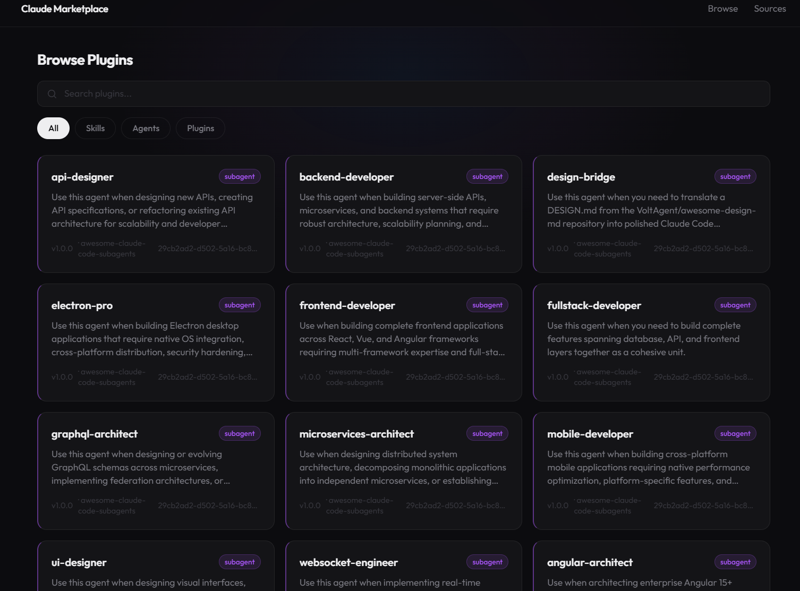
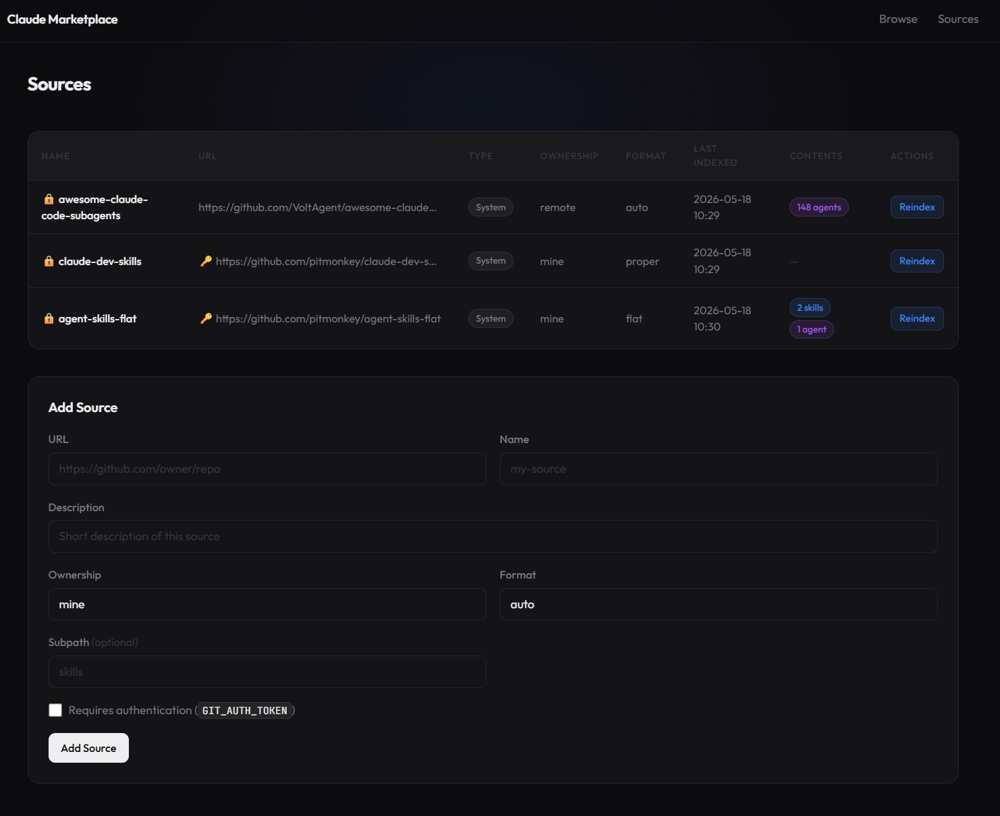

# local-ai-marketplace

A self-hosted marketplace for Claude Code and Codex skills, plus Claude Code agents. Point it at any number of Git repositories, and it indexes their skills and agents into a searchable web UI — plus a `marketplace.json` feed that Claude Code can install from directly.

## Why

Claude Code's marketplace protocol lets you add custom marketplace sources in settings. This project implements that protocol so you can:

- **Host your own private marketplace** — share internal skills and agents across a team without publishing them publicly.
- **Aggregate community sources** — pull from `awesome-claude-code-subagents` and other public repos into one searchable index; git changes are tracked and converted to version updates automatically.
- **Install one, not all** — community repos like `awesome-claude-code-subagents` contain hundreds of skills; this marketplace re-exposes each one individually so you can install exactly what you want without pulling in everything.
- **Browse before you install** — read rendered skill docs, filter by type and tags, search by name or skill content.
- **Own your index** — no dependency on any external service; runs entirely on your infrastructure.
- **Versioned skills via git** — every reindex computes a file SHA; versions increment automatically when content changes, no manual tagging needed.

**Limitation:** Skills and agents must be self-contained Markdown files. Plugins that depend on companion scripts or binaries are not supported.

## Quick Start

Sources can be configured in `config/repos.yaml` or via the UI at runtime. The supplied `config/repos.yaml` includes [VoltAgents](https://github.com/VoltAgent/awesome-claude-code-subagents).

**Docker:**

```bash
# 1. Edit config/repos.yaml to add the repos you want to index (one is included by default)

# 2. Start the server
docker compose up --build

# 3. Open the web UI
open http://localhost:8080
```

**Local (uv):**

```bash
# 1. Configure local paths and edit config/repos.yaml if needed:
cp .env.example .env

# Start the server:
uv run uvicorn src.marketplace.main:app --host 0.0.0.0 --port 8080 --reload

# 2. Open the web UI
open http://127.0.0.1:8080
```

## Add to Claude Code

Once running, register it as a marketplace source in Claude Code settings:

```
http://localhost:8080/marketplace.json
```

Skills and agents will then be available to browse and install from within Claude Code.

## Screenshots





## Features

- **Web UI** — browse plugins as cards with live search (name, description, and skill content, ranked by match relevance) and tag/type filtering (HTMX, no page reloads)
- **Plugin detail pages** — rendered Markdown docs for each skill or agent
- **Source management** — add, remove, and manually reindex Git repos via the UI or API
- **`marketplace.json` endpoint** — Claude Code-compatible plugin feed at `/marketplace.json`
- **REST API** — full JSON API at `/api` for plugins and sources
- **Two storage backends** — SQLite (default, zero config) or S3-compatible object storage
- **Docker-first** — single container, compose file included

## Configuration

See [docs/configuration.md](docs/configuration.md) for source layouts, authentication, and environment settings. Annotated examples are in [config/repos.yaml.example](config/repos.yaml.example) and [.env.example](.env.example).

## API

| Method | Path | Description |
| --- | --- | --- |
| `GET` | `/marketplace.json` | Claude Code-compatible plugin feed |
| `GET` | `/api/plugins` | List plugins (`?q=`, `?type=`, `?tags=`, `?client=`) |
| `GET` | `/api/plugins/{name}` | Get single plugin |
| `GET` | `/api/sources` | List sources |
| `POST` | `/api/sources` | Add a source |
| `DELETE` | `/api/sources/{id}` | Remove a source |
| `POST` | `/api/sources/{id}/reindex` | Re-pull and reindex a source |

## Deployment

See [docs/deployment.md](docs/deployment.md) for Kubernetes manifests, S3 backend setup, and production configuration.

## Development

Requires Python 3.12 or newer, Git, and [uv](https://docs.astral.sh/uv/). Copy `.env.example` to `.env` for local paths. See [docs/testing.md](docs/testing.md) for test patterns.

```bash
uv sync
uv run uvicorn src.marketplace.main:app --port 8080 --reload
uv run pytest
uv run ruff check src/
uv run mypy .
```

## License

MIT — see [LICENSE](LICENSE)

## Add to Codex

Register the generated Git marketplace:

```bash
codex plugin marketplace add http://localhost:8080/git.git
```

Open `/plugins`, choose `local-ai-marketplace`, install a skill, and start a new session.
Registration and HTTP cloning were verified with Codex CLI 0.166.0.
Skills with valid YAML names and descriptions are published to both clients by default.
Claude agents and native Claude plugins remain Claude-only. Installation compatibility
is not a guarantee that instructions mentioning Claude tools work unchanged in Codex.
Only self-contained Markdown skills are repackaged; scripts, references, and assets are not copied.
Existing Claude URLs, marketplace identity (`local-claude-marketplace`), and data paths remain stable.

The REST API exposes `supported_clients` and `compatibility_warnings` for each plugin;
use `/api/plugins?client=codex` or `?client=claude` to filter compatibility.
